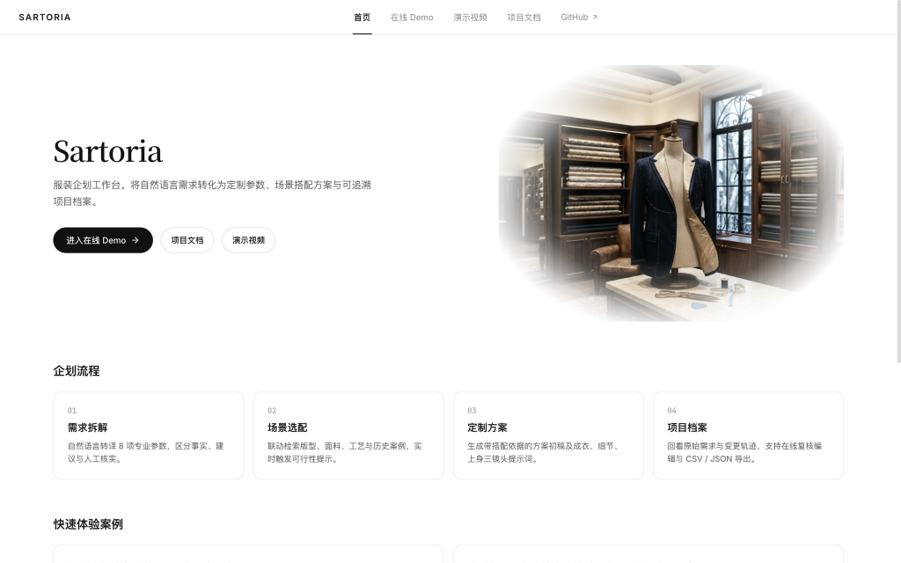

# Sartoria AI — 服装AI企划辅助系统

> 面向高级定制企划人员、定制业务专员与团体职业服方案设计师的 AI 企划决策工作台。  
> 将客户感性自然语言需求转化为可溯源的定制约束、可验证的资产组合方案、三镜头视觉需求包与版本化交接档案。
>
> - **在线官网**：https://sartoria.zichengyu.com
> - **在线工作台**：https://sartoria.zichengyu.com/demo
> - **演示视频**：https://sartoria.zichengyu.com/video（兼容 `/vedio`）
> - **系统架构文档**：https://sartoria.zichengyu.com/docs
> - **GitHub 仓库**：https://github.com/zicheng-yu/Dobe-Hackathon-Sartoria



---

## 核心能力闭环

1. **双引擎需求拆解与信息溯源（`/demo`）**  
   支持云端严格 Schema 智能解析（Cloudflare Worker + OpenAI Responses API）与本地确定性规则引擎无缝协同，将自然语言口述转化为 **8 项专业定制参数** + **6 维审美雷达**，清晰分离「**用户明确 / 系统建议 / 人工核实**」并保留逐字原话引文。
2. **硬筛方案对比、多轮改稿与混合可视化选配（`/demo/configurator`、`/demo/knowledge`）**  
   基于 36 条在用定制资产（9 款版型、13 款在用面料、11 项工艺、3 个参考案例，支持 `stylePackId` 多企业风格包扩展）执行硬约束筛选与 A/B 组合对比，透明呈现逐项匹配证据；支持多轮自然语言客户改稿预览、分支裁决与不可变版本号递进（`V1 → V2`），配合 6 大实景场景切换、工艺热点缩放、Three.js PBR 3D 面料光泽参考与 SVG 结构蓝图。
3. **带依据定制方案初稿与三镜头视觉需求包（`/demo/proposal`）**  
   一键生成含四类资产匹配依据、面料三维判断依据（风格适配 / 体感适配 / 体型适配）、可行性提示与人机分工清单的《定制方案初稿》（支持导出 Markdown 与排版打印），同步编译成衣 / 细节 / 上身氛围三镜头提示词包（即梦中文 / Midjourney / Flux）。
4. **版本化项目档案与标准化交接（`/demo/ledger`）**  
   沉淀原始需求、版本快照、人工复核状态/备注与显式前后变更 `diffSummary`，支持按任意已选版本导出 `sartoria_handoff_v1` JSON、UTF-8 BOM CSV、Markdown 交接文档及一键回载至选配工作台。
5. **完整系统架构与产品说明**  
   详见 [docs/Sartoria-AI-Solution-Architecture.md](./docs/Sartoria-AI-Solution-Architecture.md)（已同步在线渲染于 `/docs`）与跨模块数据合同 [docs/decision-contract.md](./docs/decision-contract.md)。

---

## 技术栈与边缘架构

- **前端应用**：TypeScript · React 19 · Vite 8 · Three.js · Framer Motion · Mermaid（文档页按需懒加载）
- **边缘服务与配额治理**：Cloudflare Workers（`/api/llm/status`、`/api/deconstruct`）· Cloudflare Durable Objects SQLite（`QuotaBudgetLedger` 原子日限流与预算治理）· Workers Static Assets SPA 托管

---

## 本地开发与部署

环境要求：Node.js `>= 22`

```bash
# 安装依赖并启动前端开发服务器
npm install
npm run dev

# 联调本地 Cloudflare Worker 与 Durable Objects
npm run dev:worker

# 运行自动化测试与生产构建
npm test
npm run lint
npm run build
```

项目通过 [wrangler.jsonc](./wrangler.jsonc) 接入 Cloudflare Workers Builds，监听 `main` 分支并在每次推送后自动构建上线至 `https://sartoria.zichengyu.com`。
