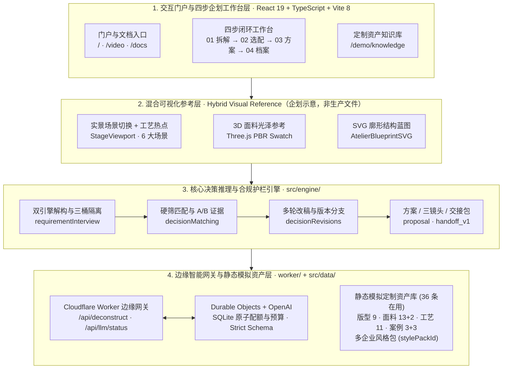
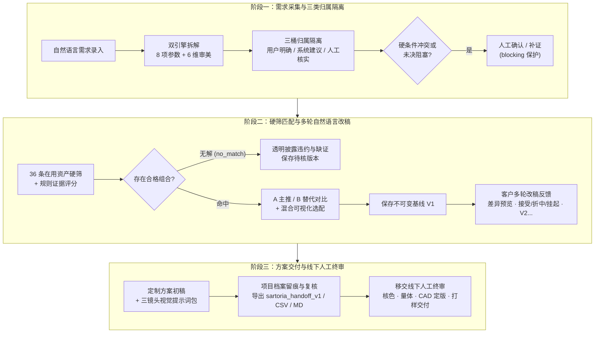
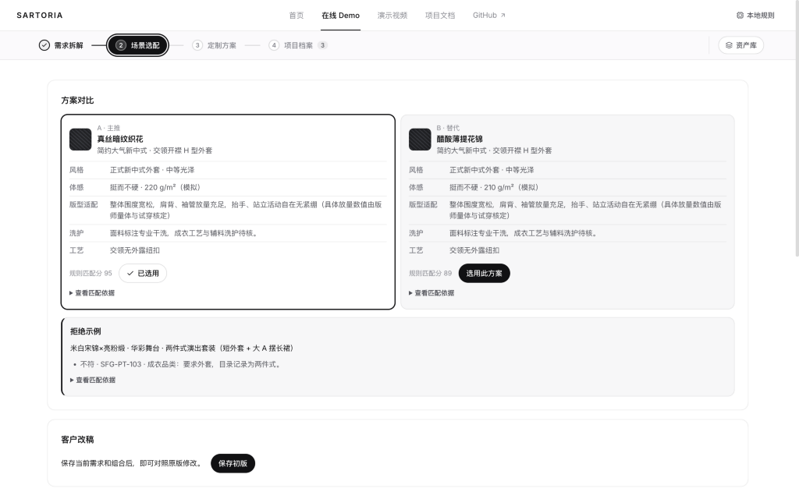
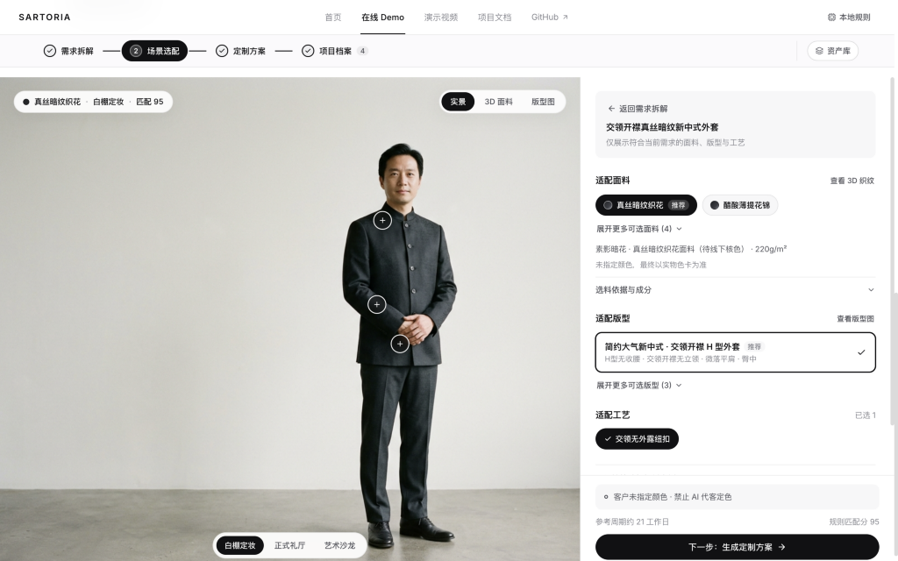
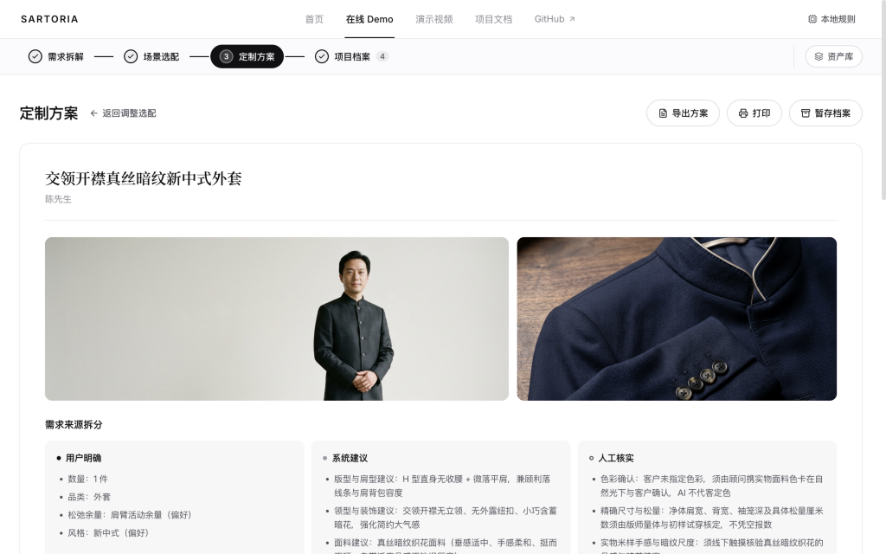
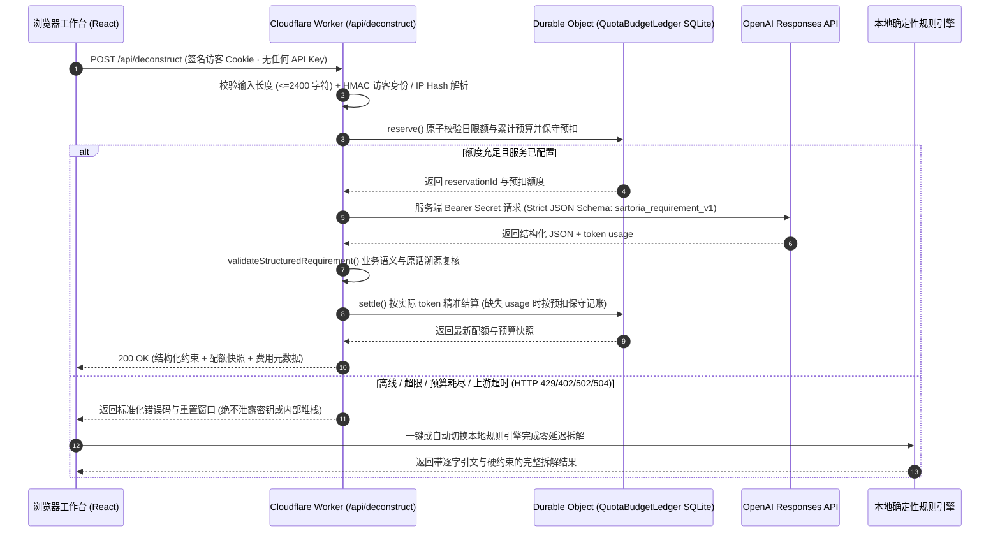

# Sartoria AI — 海派高定与团体职业服 AI 企划辅助系统

> **系统定位**：面向高级定制企划人员、定制业务专员与团体职业服方案设计师的前置 AI 企划决策工作台  
> **在线入口**：官网 [sartoria.zichengyu.com](https://sartoria.zichengyu.com) ｜ 在线工作台 [`/demo`](https://sartoria.zichengyu.com/demo) ｜ 演示视频 [`/video`](https://sartoria.zichengyu.com/video) ｜ 在线文档 [`/docs`](https://sartoria.zichengyu.com/docs) ｜ GitHub [Dobe-Hackathon-Sartoria](https://github.com/zicheng-yu/Dobe-Hackathon-Sartoria)  
> **数据与合规原则**：系统基于可溯源的静态模拟定制资产与可插拔企业风格包运行，零生产系统直连；不生成正式对外报价、不替代 CAD 定版、不调用外部生图 API、不执行打样签约或生产下单。

---

## 1. 产品愿景与核心价值

在高级定制与团体职业服的前期企划阶段，顾问与方案设计师普遍面临四类高频痛点：

- **感性口述难以精准结构化**：客户往往以体态困扰、场合氛围或穿着感受表达诉求（如“身形偏高、肩背宽厚、不要压肩不卡手臂、简约大气”或“户外舞台演奏抬手与坐奏舒展、明快上镜”），依赖人工经验口头转译易遗漏关键体态工学与排除条件。
- **存量资产检索缺少硬约束校验**：版型、面料、工艺与历史标杆案例分散在图册与人工记忆中，前期推荐容易忽略季节克重、织物与工艺兼容性、团体耐穿洗护等物理约束，也缺少逐项可查的匹配依据。
- **多轮改口难以追踪版本与连带影响**：客户在方案沟通过程中频繁调整领型、面料、光泽或排除项，传统文档与聊天记录很难清晰沉淀“原始约束是什么、本轮改了哪项、是否引发冲突、前版方案能否回溯”。
- **AI 幻觉与职责越界风险**：通用对话工具容易替未指定颜色的客户擅自定色、凭空编造厘米级松弛量，或给出缺乏依据的洗护承诺与商业报价，给线下量体定版与商业交付埋下隐患。

**Sartoria AI** 围绕「**事实与建议严格隔离、硬约束驱动可验证匹配、多轮改稿版本可追溯、人工终审闭环兜底**」四大核心设计原则，打造从自然语言需求采集到可交接企划档案的四步工作台闭环：

---

## 2. 系统总体架构设计

Sartoria AI 采用**前后端协同的四层解耦边缘架构**：前端基于 `TypeScript + React 19 + Vite 8 + Three.js` 构建交互工作台与确定性本地决策引擎，服务端依托 `Cloudflare Workers + Durable Objects (SQLite)` 承载零前端密钥暴露的云端语义解析与原子配额/预算治理，通过 `Workers Static Assets` 实现单页应用与边缘 API 的统一交付。

### 核心模块与代码分层一览

| 架构层次 | 目录 / 入口 | 核心职责与关键组件 |
| :--- | :--- | :--- |
| **交互与门户层** | `src/pages/`、`src/components/TopNav.tsx` | 统一导航、四步进度条、首页总览、需求拆解、场景选配、定制方案、项目档案、资产库、演示视频及支持 Mermaid 与图文渲染的在线文档页。 |
| **混合可视化层** | `src/components/StageViewport.tsx`、`FabricSwatch3D.tsx`、`AtelierBlueprintSVG.tsx`、`RadarChartSVG.tsx` | 提供白棚/礼厅/户外舞台/沙龙/晚宴/峰会 6 场景实景切换、工艺热点聚焦、Three.js PBR 织物光泽预览、SVG 结构蓝图与 6 维审美雷达图。 |
| **决策与护栏引擎** | `src/engine/`、`src/types/decisions.ts`、`src/utils/decisionHandoff.ts` | 跨模块决策数据合同、本地确定性语义规则引擎、三桶归属隔离、硬条件过滤与证据生成、多轮改稿预览与分支裁决、五维可行性护栏、方案/提示词编译及标准交接导出。 |
| **边缘智能网关** | `worker/index.ts`、`worker/quotaLedger.ts`、`worker/schema.ts`、`worker/pricing.ts`、`worker/visitorAuth.ts` | 服务端安全托管上游密钥，以 HMAC 访客身份与 Durable Objects SQLite 实现原子限流与累计预算封顶，对模型输出执行严格 JSON Schema 与业务语义复核。 |
| **静态模拟资产层** | `src/data/`（`patterns`、`fabrics`、`crafts`、`cases`、`scenes`、`stylePacks`、`decisionCatalog`） | 结构化沉淀在用定制资产与属性证据，逐项标注数据来源与 `simulated: true` 标识，通过 `stylePackId` 支持跨品牌/品类的资产包扩展。 |

---

## 3. 端到端四步企划工作台与实机效果

Sartoria AI 将前置定制企划收敛为清晰可控的四步决策闭环，并在所有可能引发越界或冲突的节点嵌入人工裁决闸口：

### 3.1 步骤一：需求拆解与三类信息隔离（`/demo`）

输入任意自然语言定制描述（支持自由文本新建简报，亦内置 7 套典型高定与团体职业服示例场景），系统自动转译为 **8 项专业定制参数**（品类、版型结构、领型、面料、色彩、装饰纹样、长度比例、松弛余量）与 **6 维结构化审美雷达图**。

- **严格三桶分离与来源标注**：每项参数与约束明确区分为 `用户明确`、`系统建议` 与 `待确认 / 人工核实`，并保留对应输入轮次与逐字原话摘句（`sourceTurnId` / `quote`）。
- **显式排除（`neq`）与防幻觉保护**：精准识别“不要立领”“不要亮面”“不要传统制服”等否定表达；客户未指定颜色时绝不代客定色，松弛余量只给方向性建议、绝不凭空编造具体厘米数值。
- **可交互约束核对面板**：业务专员可在进入选配前直接在线编辑、确认或补充硬条件，避免上游误判传入下游推荐。

### 3.2 步骤二：硬筛方案对比、多轮改稿与混合可视化选配（`/demo/configurator`）

进入场景选配页后，工作台由上至下依次提供「**硬筛方案对比**」「**多轮客户改稿**」与「**混合可视化选配舞台**」三大协同区域：

1. **A/B 合格方案对比与透明拒因**：仅向专员呈现通过全部硬条件筛选的合格组合（`A · 主推` 与 `B · 替代`），逐维度对照风格、体感、版型适配、洗护与工艺，并可展开逐条 `AssetEvidence`（含资产编码、字段判定与出处）。对于违约或关键属性缺失的候选，透明展示拒绝与待核示例；若当前硬条件在目录中无解，系统明确进入 `no_match` 状态并阻断不可靠推荐。
2. **多轮自然语言改稿与版本分支**：保存基线版本（`V1`）后，顾问可直接粘贴客户新一轮改口意见（如更换面料、调整领型、撤回某条限制或增加耐皱/机洗要求）。系统先计算字段级差异预览与连带影响，支持按「接受 / 折中 / 挂起」分支处理，**未人工确认前绝不改写原冻结版本**，确认后自动推进不可变版本号（`V1 → V2 → ...`）。

3. **混合可视化参考舞台（Hybrid Visual Reference）**：
   - **实景参考与工艺热点**：支持在白棚定妆、正式礼厅、户外舞台、艺术沙龙、外滩晚宴与陆家嘴峰会等场景间切换光影氛围，点击成衣热点可缩放聚焦肩领、袖笼或盘扣工艺细节。
   - **Three.js PBR 3D 面料光泽参考**：实时渲染织物基底色、经纬暗纹与光泽粗糙度，辅助直观理解哑光、柔光与缎面质感差异。
   - **SVG 廓形结构蓝图**：示意领型弧度、肩线落位与衣长比例，明确标注仅作企划参考、非 CAD 生产纸样。
   - **五维可行性实时护栏**：所有选配面板仅展示符合当前硬条件的合格选项，同步校验季节克重、工艺-面料物理兼容性、团体职业服耐穿规范、参考工期估算及未定色核验提醒。

### 3.3 步骤三：带依据定制方案初稿与三镜头视觉需求包（`/demo/proposal`）

确定选配组合后，系统一键编译结构化《定制方案初稿》与三镜头标准化视觉提示词包：

- **可审计方案初稿**：完整汇总需求来源拆分（用户明确 / 系统建议 / 人工核实）、8 项定制参数、四类静态资产搭配依据、面料三维判断依据（**风格适配 / 体感适配 / 体型适配**）、可行性提示、六步人机分工与人工终审核对清单，支持一键导出 Markdown 文档及浏览器排版打印/PDF。
- **三镜头视觉需求包**：围绕「成衣结构全貌」「领襟与面料细节」「上身氛围场景」三组镜头，同步输出适配 **中文描述（即梦）/ Midjourney / Flux** 的标准化提示词及必保结构约束。系统不调用外部生图 API，并在未定色场景中显式声明画面色泽仅作结构示意，实物色号须以线下米样为准。

### 3.4 步骤四：版本化项目档案与标准化交接（`/demo/ledger`）

所有已保存版本与人工操作均自动沉淀至项目档案台账，形成可回溯、可编辑、可交接的业务闭环：

- **版本对比与标准交接**：按项目集中管理 `V1 / V2 ...` 不可变版本快照（含无匹配时的待核档案），支持切换查看任意历史版本、检视逐字段变更轨迹，并一键导出结构化 `sartoria_handoff_v1` JSON 或可读交接 Markdown。
- **人工复核编辑与全流程 Diff 留痕**：专员可在台账中在线修订项目名称、客户信息、流转状态（`AI草稿` → `待业务专员复核` → `待版师/报价终审` → `已归档`）与复核备注，系统自动记录显式前后变更摘要（`diffSummary`），并支持 UTF-8 BOM CSV / JSON / 打印导出及一键回载至选配工作台继续迭代。

---

## 4. 核心引擎与关键技术机制

### 4.1 双引擎语义解析与边缘安全配额治理

为兼顾开放自然语言的泛化理解能力与生产演示场景下的高可用、成本可控与密钥安全，Sartoria AI 构建了「**云端边缘智能引擎 + 本地确定性规则引擎**」双轨协同架构：

关键安全与成本控制机制：

- **零客户端密钥暴露**：上游模型 `OPENAI_API_KEY` 与访客签名密钥 `VISITOR_SIGNING_SECRET` 仅托管于 Cloudflare Worker Secrets，浏览器端不保存、不传输任何敏感凭据；所有结构化可观测日志自动脱敏，不记录密钥、原始 IP 或客户原始口述文本。
- **原子级多维限流与预算封顶**：通过单体 SQLite Durable Object (`QuotaBudgetLedger`) 实现强一致并发控制——单访客每日限 5 次、单 IP 每日限 5 次、全站每日限 50 次（按 `Asia/Shanghai` 每日 00:00 重置），并叠加**项目累计 USD 40.00 终身硬预算上限**（不随日期重置）；请求前按最坏 Token 上限保守预扣，请求后按实耗微美元精确结算。
- **双层输出校验与无感降级**：云端模型强制启用 `Strict JSON Schema`（`sartoria_requirement_v1`），服务端进一步执行业务语义校验防止越界或格式漂移；一旦遇到网络离线、配额用尽或上游超时，工作台可立即切换至本地确定性规则引擎继续完成全部四步流程。

### 4.2 跨模块决策数据合同与防幻觉护栏

系统在 `src/types/decisions.ts` 中定义了强类型的跨模块决策合同（详细字段规范参见 [decision-contract.md](./decision-contract.md)），确保从需求访谈到资产匹配、多轮改稿与交接导出的全链路语义一致：

| 合同对象 | 核心数据结构与防幻觉护栏机制 |
| :--- | :--- |
| **`DecisionRequirement`** | 完整保存每轮客户原话 `turns`；所有显式硬条件与排除项（`op: 'neq'`）均绑定 `sourceTurnId` 与逐字 `quote`；字段缺失或同轮冲突时置 `null` 并标为 `blocking: true`，须经人工确认后方可用于推荐。 |
| **`AssetEvidence`** | 每条筛选结论关联目录 `assetId` / `assetCode`、结构化属性、来源类型与 `simulated: true` 标记；明确违约归入 `rejected`，关键洗护/工艺属性缺证归入 `needs_review`，历史案例仅作风格参考而不填补成衣物理事实。 |
| **`MatchResult`** | `recommended` 与 `alternative` 严格只放通过全部硬约束筛选的组合；若无合格项则诚实返回 `no_match` 并输出可追溯的拒绝与待核清单，绝不强行凑数推荐。 |
| **`Revision` / `Version`** | 改稿预览在确认前保持与基线完全隔离；支持针对单条约束的显式撤回（`withdraws`），同时无损保留同字段与其他字段的既有硬条件；仅确认后生成递增版本号并记录前版引用。 |
| **`DecisionExport`** | 固定契约 `sartoria_handoff_v1`，从同一已选不可变版本导出客户原话、选定组合与匹配证据、版本差异、待核负责人清单及静态模拟资产声明，保障重开与导出逐字节一致。 |

---

## 5. 定制资产知识库与可扩展企业风格包

### 5.1 静态模拟定制资产目录与溯源规范

系统内置结构化静态模拟定制目录（存放于 `src/data/`），全量资产均显式标记 `simulated: true` 及来源类别（参考案例整理 / 公开织物与洗护标准如 GINETEX、CottonWorks / 模拟合成属性），**不包含任何真实客户隐私、商业底价或实时库存数据**：

- **在用匹配目录共 36 条记录**：
  - **版型库（9 款，`src/data/patterns.ts`）**：涵盖交领开襟 H 型外套、低立领直身外套、窄青果领外套、自然落肩外套、两件式舞台演出套装、海派立领与平驳领团体职业套装（`SFG-PT-201-L` 独立建档）、修身长礼服及极简无结构商务套装。
  - **面料库（13 款在用匹配 + 2 款视觉展示，`src/data/fabrics.ts`）**：覆盖真丝暗纹织花、醋酸薄提花锦、梅花暗纹宋锦、米白宋锦与亮面缎面组合、非遗哑光香云纱、Super 130s 精纺羊毛及抗皱机洗功能混纺等，附成分、克重、光泽与洗护核验标注。
  - **工艺库（11 项，`src/data/crafts.ts`）**：覆盖交领无外露纽扣对位、短颈低立领人体工学定型、梅花星光暗纹、撞色镶滚宕条、手工琵琶盘扣、苏绣玉兰、全毛衬归拔、暗门襟、易护耐洗缝制等，并绑定版型与面料物理兼容矩阵。
  - **历史参考案例（3 个在用参考 + 3 个归档参考，`src/data/cases.ts`）**：供顾问快速对照体态、场合与选配先例，可一键载入当前工作台复用试配。
- **场景灯光环境库（6 大场景，`src/data/scenes.ts`）**：白棚定妆、正式礼厅、户外音乐舞台、静安艺术沙龙、外滩晚宴、陆家嘴金融峰会。

### 5.2 多企业风格包扩展架构（`stylePackId`）

系统将「推理匹配引擎」与「企业定制资产」彻底解耦，通过 `stylePackId` 抽象支持跨品牌、跨品类快速迁移：

- **`shanghai-haipai`（海派高定与职业服体系）**：默认风格包，归集海派改良立领、手工琵琶盘扣、真丝镶滚宕条、宋锦/香云纱/精纺羊毛等东方风骨与建筑感剪裁资产。
- **`minimal-executive`（极简国际商务扩展体系）**：扩展演示风格包，采用无结构柔肩廓形、极简暗扣与商旅抗皱精纺，验证仅替换静态资产包即可将整套需求拆解、硬筛匹配、多轮改稿与台账引擎复用于其他定制品牌。

### 5.3 典型覆盖业务场景

| 场景类别 | 典型定制需求特征 | 系统核心应对机制 |
| :--- | :--- | :--- |
| **高定新中式正装外套** | 身形偏高/肩背宽厚/短颈/肚腩/溜肩等体态痛点；不压肩不卡臂；未指定颜色 | 转译为 H 型微落平肩 / 低立领 / 交领开襟及肩腹放量方向；触发「未定色不代客定色」与「松量不虚报厘米数」双重护栏。 |
| **两件式舞台演出套装** | 外套 + 连衣裙组合；户外舞台氛围；演奏抬手与坐奏舒展；明确色彩明快上镜 | 区分单件与两件式结构匹配，协调宋锦短外套与大 A 摆缎面长裙的动态活动余量，并将舞台核色与鞋跟裙长列入人工试身核对项。 |
| **中大型团体职业服** | 20–200 人男女同源套系；四季抗皱耐穿、易护洗护、久坐不塌肩；排除传统老气制服 | 激活批量起订量范围校验、耐穿抗皱与机洗证据审计，自动拦截娇贵纯丝/高克重不适配面料并标示违约原因。 |
| **高端晚宴与礼仪礼服** | 特定光影场景（老洋房晚宴/艺术沙龙）、非遗刺绣与盘扣工艺、修长廓形 | 联动场景光影与工艺热点预览，提供工艺-面料物理兼容校验及三镜头上身氛围视觉提示词包。 |

---

## 6. 质量保障、工程评测与部署运维

### 6.1 自动化测试与多维回归体系

Sartoria AI 建立了覆盖单元推理、边缘安全、离线盲测与端到端浏览器的多层次工程质量防线：

- **核心与边界自动化测试（`npm test`：22 个测试文件、282 项测试全部通过）**：
  - 覆盖需求抽取与条款切分（`requirementInterview` / `requirementClauses` / `requirementDomain`）、否定与排除立场识别（`requirementInterviewStance`）、数量与业务作用域（`requirementQuantityScope`）、色彩范围与未定色保护（`colorScope.test.ts` / `referenceColorScope.test.ts`）。
  - 覆盖硬筛匹配、拒绝/待核归类与无匹配保护（`decisionMatching.test.ts`）、多轮改稿差异/冲突与不可变版本（`decisionRevisions.test.ts`）、标准交接导出一致性（`decisionHandoff.test.ts`）。
  - 覆盖 Cloudflare Worker 并发配额预扣、USD 40 硬预算封顶、输入长度校验与密钥零泄露（`worker/__tests__/quotaAndSecurity.test.ts`），以及冻结云端响应的零成本离线回放测试（`evaluation/astraReplay.test.ts`）。
- **多批次冻结盲测放行套件（`npm run test:release`）**：针对 5 组独立标注的冻结简报集检验硬约束精确率/召回率、`neq` 否定识别、零已知违约推荐、零库外 ID、零无证据属性断言以及多轮改稿未改条件全量保留。
- **离线 Chromium 端到端浏览器回归（`evaluation/browser/run.mjs`）**：在真实构建产物 `dist/` 上断网验证离线可用性、两轮改稿后刷新重开与 JSON/Markdown 逐字节一致导出，以及模拟上游 HTTP 504 / 非法 JSON 故障时的自动本地回退。

### 6.2 边缘构建与自动化发布

- **统一边缘交付（`wrangler.jsonc`）**：通过 `assets.run_worker_first: ["/api/*"]` 与 `not_found_handling: "single-page-application"` 实现同一域名下前端静态资源与边缘 API 的零跨域协同，Durable Objects 通过 `migrations` 自动管理 SQLite 表结构。
- **GitHub 自动同步构建**：接入 Cloudflare Workers Builds 监听 `main` 分支，每次代码合并或文档更新推送后自动执行 `tsc -b && vite build` 并同步上线至 `https://sartoria.zichengyu.com`。

---

## 7. 人机能力边界与演进路线

### 7.1 Agent 能力边界清单

为保障高定与团体职业服业务的专业严谨性、商业风控与生产安全，Sartoria AI 在界面交互、推理引擎与导出档案中全链路贯彻以下人机权责边界：

| 业务环节 | Agent 辅助范围（可做） | 明确禁止越界事项（严禁） | 人工终审责任岗 | 系统内建护栏 |
| :--- | :--- | :--- | :--- | :--- |
| **1. 需求采集与语言转译** | 接收自然语言描述；拆解为 8 项专业参数、6 维审美雷达及「用户明确 / 系统建议 / 人工核实」三类清单 | 不代客决定未指定的色彩；不凭空报具体厘米松量数值；不替代人工进行客户需求确认签字；不采集真实客户敏感隐私 | 定制业务专员 / 高定企划人员 | 逐项绑定原话引文与来源标签；未定色与冲突项自动标为待核或阻塞 |
| **2. 资产检索与硬筛选配** | 基于静态模拟资产库执行硬条件过滤与 A/B 组合对比；输出逐项属性证据、三维选料依据与可行性风险提示 | 不接入真实 ERP/PLM/MES 库存与生产接口；不替代版师锁定工艺单或特体放量参数；不以历史案例替代物理属性证据 | 职业服方案设计师 / 资深版师 | 全站与导出文件标明 `simulated: true`；物理违约拦截并透明披露拒因 |
| **3. 方案初稿与视觉需求包** | 生成《定制方案初稿》与适配即梦 / Midjourney / Flux 的三镜头提示词包；提供 SVG 结构蓝图与 3D 织物光泽参考 | **不调用外部生图 API、不做现场自动出图**；**不做 CAD 正式定版**（SVG 示意图非生产纸样）；不以屏幕参考替代实物米样核色 | 高定企划人员 / 资深版师 | 方案与提示词明确标注企划初稿属性与线下核色声明 |
| **4. 线下打样与成衣制作** | 在方案中汇总供版师与顾问参考的试身核对要点（肩背压肩、袖笼活动量、领高弧度、衣长与坐姿比例） | **不执行打样、不排产、不下达裁剪缝制指令、不承担成衣品控交付** | 资深版师 / 工坊工艺师 | 流程明确界定 CAD 定版、毛样试身与成衣交付属于线下人工终审执行 |
| **5. 商务报价、签约与档案** | 记录静态参考周期估算；沉淀多版本变更 Diff 与人工复核备注；支持 `sartoria_handoff_v1` JSON / CSV / MD / 打印导出 | **严禁生成正式对外报价单、审批折扣、承诺正式交期、签订商务合同、触发收款或生产下单** | 定制业务专员 / 商务经理 | 全站零报价、零支付、零下单入口；系统流转止步于人工复核归档 |

### 7.2 分阶段演进路径与风险治理

#### 分阶段演进规划

1. **阶段一 · 零耦合前置企划工作台（当前已上线）**：跑通双引擎需求拆解、硬约束 A/B 对比、多轮改稿版本控制、混合可视化选配、带依据方案初稿、三镜头提示词与标准化交接档案，以零生产系统耦合形态支持顾问与设计师即时试用。
2. **阶段二 · 企业脱敏资产治理与内部审核闭环**：引入企业版型/面料/工艺知识库管理机制，由资深版师与采购团队维护结构化属性证据、色卡编号、洗护验证状态与工艺禁忌规则，沉淀内部可复用的风格包与标杆案例库。
3. **阶段三 · 人工审批驱动的下游系统单向衔接**：在通过企业信息安全与合规审计后，通过标准化 `sartoria_handoff_v1` 单据与人工审批闸口，向内部 CRM 或企划系统单向同步已核定档案，始终保留量体定版与商务报价的人工终审权。

#### 关键风险评估与内建控制机制

| 风险类别 | 潜在业务 / 技术风险 | 系统内建控制机制 |
| :--- | :--- | :--- |
| **AI 替客定色或虚构尺寸** | 模型对未指定颜色擅自拍板，或凭空编造厘米级放量误导沟通 | 强制分离「用户明确 / 系统建议 / 人工核实」；未定色触发护栏并阻断代客定色；松弛余量仅输出方向建议。 |
| **屏幕参考与实物色差误解** | 客户将 3D 光泽预览、SVG 蓝图或提示词效果图误认为定版纸样或实物色泽 | 选配台、方案初稿与视觉需求包均显式声明非生产纸样，实物色泽与手感须以线下标准光源米样核验为准。 |
| **无解硬条件强行推荐** | 客户多轮改口引发冲突或超出目录能力时输出不可行方案 | 硬筛引擎严格区分合格、待核与拒绝，无合格组合时进入 `no_match` 并支持保存待核档案交人工接手。 |
| **云端模型滥用、超时或密钥泄露** | 公开 Web 入口遭遇刷量超支、上游波动中断或前端泄露 API Key | Cloudflare Worker 服务端托管密钥，Durable Objects SQLite 执行单访客/全站日限额与 USD 40 终身硬顶，异常无缝切回本地规则引擎。 |
| **越权报价、签约或排产** | 企划辅助工具越界输出商业底价或触发生产下发 | 全系统无报价、合同、支付及生产下发接口；周期字段明示“静态库参考估算，非正式交期承诺”。 |
