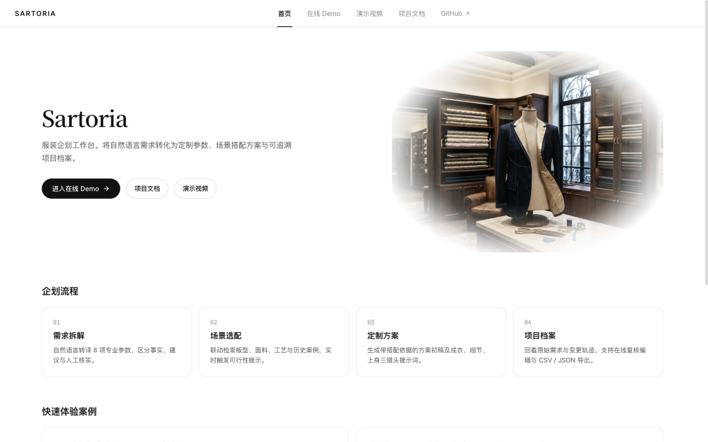
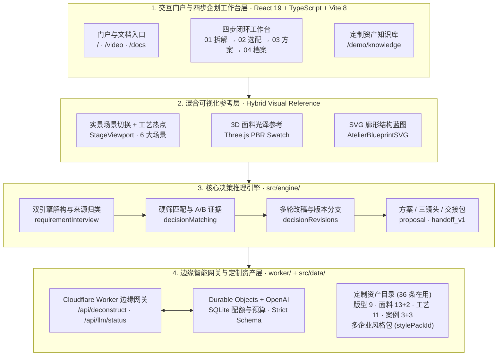
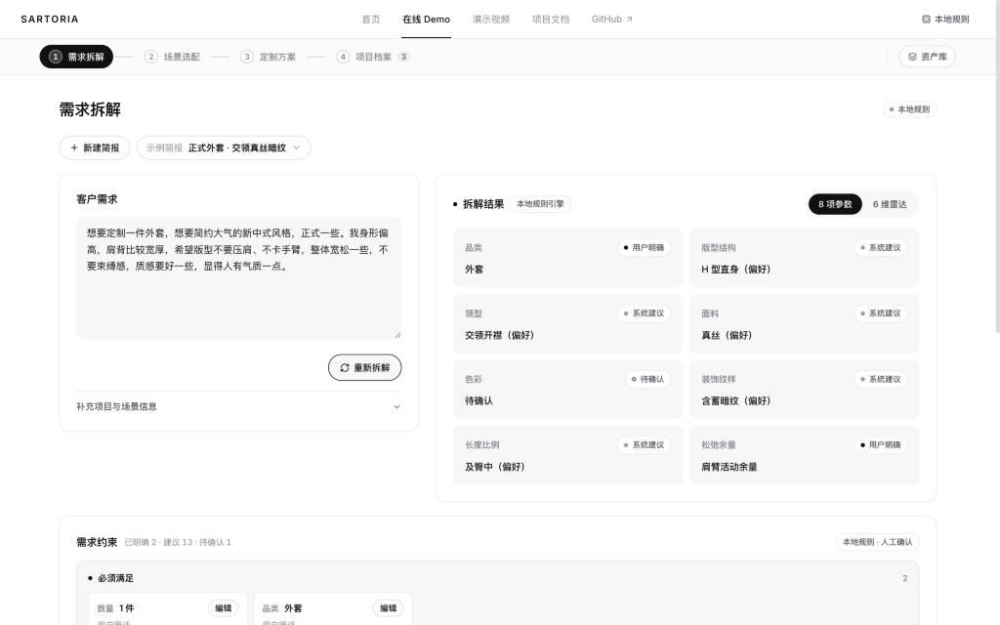
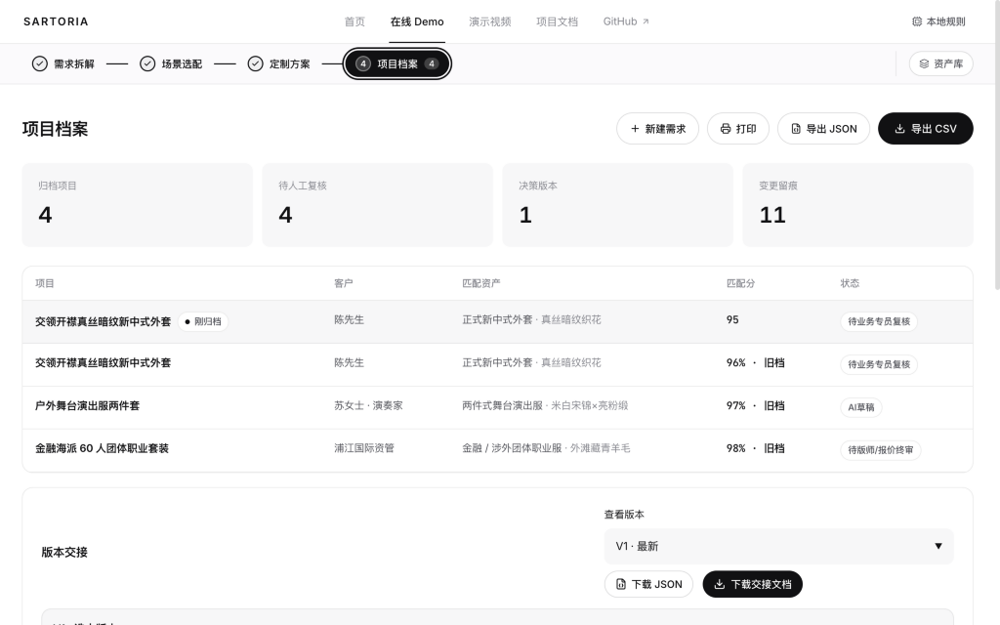
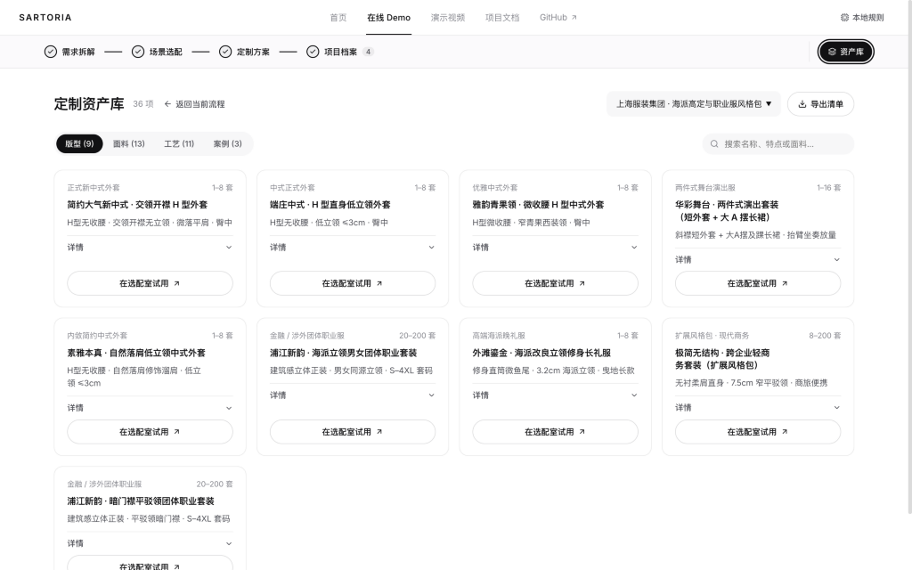

# Sartoria AI — 服装AI企划辅助系统

> **系统定位**：面向高级定制企划人员、定制业务专员与团体职业服方案设计师的 AI 企划决策工作台  
> **在线入口**：官网 [sartoria.zichengyu.com](https://sartoria.zichengyu.com) ｜ 在线工作台 [`/demo`](https://sartoria.zichengyu.com/demo) ｜ 演示视频 [`/video`](https://sartoria.zichengyu.com/video) ｜ 在线文档 [`/docs`](https://sartoria.zichengyu.com/docs) ｜ GitHub [Dobe-Hackathon-Sartoria](https://github.com/zicheng-yu/Dobe-Hackathon-Sartoria)

---

## 1. 产品愿景与核心价值

在高级定制与团体职业服的前期企划阶段，顾问与方案设计师普遍面临四类核心挑战：

- **感性口述难以精准结构化**：客户通常以体态困扰、场合氛围或穿着感受表达诉求（如“身形偏高、肩背宽厚、不要压肩不卡手臂、简约大气”或“户外舞台演奏抬手与坐奏舒展、明快上镜”），依赖口头记录容易遗漏关键体态工学与排除条件。
- **存量资产检索缺少依据支撑**：经典版型、特色面料、精工工艺与历史标杆案例分散在图册与经验中，前期选配需要同时兼顾季节克重、织物与工艺兼容性、团体耐穿洗护等约束条件，并给出清晰可查的推荐理由。
- **多轮改口难以追踪版本演进**：客户在方案沟通过程中会持续调整领型、面料、光泽或约束项，传统沟通方式很难完整回溯“原始需求是什么、本轮变更了哪项、是否引发连带影响”。
- **跨角色沟通缺少统一载体**：顾问、版师与客户之间需要兼顾直观视觉感受与结构化专业参数的标准化方案载体，让前期企划成果能够平滑衔接线下量体、核色与制版环节。

**Sartoria AI** 聚焦前期定制企划全链路，以「**需求可溯源、匹配有证据、改稿有版本、交接有标准**」为核心能力，构建从自然语言录入到标准化企划档案交付的四步智能工作台：

---

## 2. 系统总体架构设计

Sartoria AI 采用**前后端协同的四层解耦边缘架构**：前端基于 `TypeScript + React 19 + Vite 8 + Three.js` 构建交互工作台与本地确定性推理引擎，服务端依托 `Cloudflare Workers + Durable Objects (SQLite)` 承载云端语义解析与配额预算治理，并通过 `Workers Static Assets` 实现单页应用与边缘 API 的统一交付。

### 核心模块与代码分层一览

| 架构层次 | 目录 / 入口 | 核心职责与关键组件 |
| :--- | :--- | :--- |
| **交互与门户层** | `src/pages/`、`src/components/TopNav.tsx` | 统一导航、四步进度条、首页总览、需求拆解、场景选配、定制方案、项目档案、资产库、演示视频及支持 Mermaid 与图文混排的在线文档页。 |
| **混合可视化层** | `src/components/StageViewport.tsx`、`FabricSwatch3D.tsx`、`AtelierBlueprintSVG.tsx`、`RadarChartSVG.tsx` | 提供白棚、礼厅、户外舞台、艺术沙龙、外滩晚宴与陆家嘴峰会 6 大场景切换、工艺热点聚焦、Three.js PBR 织物光泽预览、SVG 结构蓝图与 6 维审美雷达图。 |
| **核心决策引擎** | `src/engine/`、`src/types/decisions.ts`、`src/utils/decisionHandoff.ts` | 跨模块决策数据合同、本地确定性语义规则引擎、三类信息来源归类、硬条件筛选与证据生成、多轮改稿预览与分支裁决、五维可行性校验、方案/提示词编译及标准交接导出。 |
| **边缘智能网关** | `worker/index.ts`、`worker/quotaLedger.ts`、`worker/schema.ts`、`worker/pricing.ts`、`worker/visitorAuth.ts` | 服务端安全托管上游凭据，以 HMAC 访客身份与 Durable Objects SQLite 实现原子限流与累计预算管控，并对云端模型输出执行严格 JSON Schema 与语义校验。 |
| **定制资产层** | `src/data/`（`patterns`、`fabrics`、`crafts`、`cases`、`scenes`、`stylePacks`、`decisionCatalog`） | 结构化沉淀版型、面料、工艺、历史案例与场景资产，逐项记录结构化属性与参考来源，并通过 `stylePackId` 支持多品牌风格包扩展。 |

---

## 3. 四步企划工作台与实机效果

Sartoria AI 将前置定制企划收敛为清晰连贯的四步决策闭环，兼顾自然语言交互效率与专业企划的可控性。

### 3.1 步骤一：需求拆解与信息溯源（`/demo`）

支持自由输入任意客户口述简报（亦内置 7 套典型高定与团体职业服示例场景），系统自动转译为 **8 项专业定制参数**（品类、版型结构、领型、面料、色彩、装饰纹样、长度比例、松弛余量）与 **6 维结构化审美雷达图**。

- **三类信息来源分离**：逐项清晰标示 `用户明确`、`系统建议` 与 `待确认 / 人工核实`，并关联对应输入轮次与逐字原话摘句（`sourceTurnId` / `quote`）。
- **语义排除与待核保留**：准确解析“不要立领”“不要亮面”“不要传统制服”等显式排除条件（`neq`）；对客户未提及的色彩、需实测的厘米级松量自动归入待确认清单，交由顾问线下核定。
- **交互式约束核对面板**：业务专员可在进入选配前直接在线微调、确认或补充硬条件，确保上游语义准确传递至下游匹配。

### 3.2 步骤二：硬筛方案对比、多轮改稿与混合可视化选配（`/demo/configurator`）

场景选配页由「**硬筛方案对比**」「**多轮客户改稿**」与「**混合可视化选配舞台**」三大协同区域组成：

1. **A/B 合格方案对比与依据展开**：依据全部硬条件从目录中筛选合格组合，输出 `A · 主推` 与 `B · 替代` 并排对照风格、体感、版型适配、洗护与工艺，支持展开查看逐项 `AssetEvidence`（含资产编码、字段判定与出处）。对不符条件的组合同步展示拒绝或待核示例；若条件冲突或目录暂缺合适项，系统明确进入 `no_match` 状态并支持保存待核档案。
2. **多轮自然语言改稿与版本演进**：保存基线版本（`V1`）后，顾问可直接粘贴客户新一轮反馈（如更换面料、调整领型、撤回某条限制或新增耐皱/机洗要求）。系统自动计算字段级差异预览与连带影响，支持按「接受 / 折中 / 挂起」分支裁决，确认后推进不可变版本号（`V1 → V2 → ...`）。

3. **混合可视化参考舞台（Hybrid Visual Reference）**：
   - **实景参考与工艺热点**：支持在白棚定妆、正式礼厅、户外舞台、艺术沙龙、外滩晚宴与陆家嘴峰会 6 大场景间切换光影氛围，点击热点可缩放检视肩领、袖笼或盘扣工艺细节。
   - **Three.js PBR 3D 面料光泽参考**：实时渲染织物基底色、经纬暗纹与光泽粗糙度，直观对比哑光、柔光与缎面质感。
   - **SVG 廓形结构蓝图**：示意领型弧度、肩线落位与衣长比例，辅助顾问与客户快速对齐成衣结构意向。
   - **五维可行性实时提示**：选配面板动态过滤合格选项，同步校验季节克重、工艺-面料物理兼容性、团体职业服耐穿规范、参考工期估算及待核色提醒。

### 3.3 步骤三：定制方案初稿与三镜头视觉需求包（`/demo/proposal`）

选定组合后，系统一键生成结构化《定制方案初稿》与三镜头标准化视觉需求包：

- **带依据的方案初稿**：汇总需求来源拆分（用户明确 / 系统建议 / 人工核实）、8 项定制参数、四类资产搭配依据、面料三维判断依据（**风格适配 / 体感适配 / 体型适配**）、可行性提示与人机分工核对清单，支持一键导出 Markdown 及浏览器排版打印/PDF。
- **三镜头视觉需求包**：围绕「成衣结构全貌」「领襟与面料细节」「上身氛围场景」三组镜头，同步编译适配 **中文描述（即梦）/ Midjourney / Flux** 的标准化提示词及必保结构约束，方便设计团队或外部视觉工具直接复用。

### 3.4 步骤四：版本化项目档案与标准化交接（`/demo/ledger`）

所有已保存版本与人工复核记录均沉淀至项目档案台账，形成可回看、可编辑、可导出的完整闭环：

- **多版本追踪与标准交接**：按项目集中归档 `V1 / V2 ...` 不可变版本快照（含待核版本），支持回溯任意历史版本的原始需求与匹配依据，并一键导出结构化 `sartoria_handoff_v1` JSON 或可读交接 Markdown 文档。
- **在线复核与变更 Diff 留痕**：专员可直接在台账中更新项目信息、流转状态（`AI草稿` → `待业务专员复核` → `待版师/报价终审` → `已归档`）与复核备注，系统自动生成前后变更摘要（`diffSummary`），支持 UTF-8 BOM CSV / JSON / 打印导出及一键回载至选配工作台继续迭代。

---

## 4. 核心引擎与技术机制

### 4.1 双引擎语义解析与边缘治理

为兼顾开放自由文本的深度语义理解与离线/高并发场景下的稳定响应，Sartoria AI 采用「**云端边缘智能引擎 + 本地确定性规则引擎**」双轨协同架构：

- **云端结构化智能解析**：浏览器经由同域 Cloudflare Worker (`/api/deconstruct`) 发起请求，服务端托管上游凭据并调用 OpenAI Responses API（强制启用 `Strict JSON Schema: sartoria_requirement_v1`），随后由 `validateStructuredRequirement()` 执行二次语义与原话溯源复核，输出稳定可靠的结构化定制约束。
- **Durable Objects 原子配额与预算管控**：通过单体 SQLite Durable Object (`QuotaBudgetLedger`) 结合 HMAC 访客身份与 IP Hash 实现并发安全的限流与预算治理（单访客每日 5 次、全站每日 50 次，按 `Asia/Shanghai` 每日 00:00 重置；项目累计 USD 40.00 硬预算上限），请求前按上限保守预扣、响应后按实耗 Token 精准结算。
- **本地确定性规则引擎无缝衔接**：内置零依赖本地领域语义规则引擎（`requirementInterview` / `requirementClauses`），在离线预览、配额用尽或上游波动时可一键无感切换，保障四步企划流程持续可用。

### 4.2 跨模块决策数据合同

系统在 `src/types/decisions.ts` 中统一定义了跨模块决策数据合同（完整规范见 [decision-contract.md](./decision-contract.md)），确保需求访谈、资产筛选、多轮改稿与交接导出共享同一份可验证的语义模型：

| 合同对象 | 核心数据结构与能力机制 |
| :--- | :--- |
| **`DecisionRequirement`** | 完整保留每轮客户原话 `turns`；所有显式硬条件与排除项（`op: 'neq'`）均绑定 `sourceTurnId` 与逐字 `quote`；缺失或冲突字段显式标记 `blocking: true` 引导人工核定。 |
| **`AssetEvidence`** | 每条匹配结论均关联目录 `assetId` / `assetCode`、结构化属性及数据来源，清晰区分符合、待核（`needs_review`）与违约（`rejected`），让推荐结果有据可查。 |
| **`MatchResult`** | `recommended` 与 `alternative` 严格呈现满足全部硬条件的合格组合；无合格项时返回 `no_match` 并保留完整拒因与待核列表。 |
| **`Revision` / `Version`** | 改稿预览在人工确认前与原版隔离，支持针对单条条件的显式撤回（`withdraws`）并完整保留既有硬条件；确认后生成递增不可变版本号并记录前版引用。 |
| **`DecisionExport`** | 固定契约 `sartoria_handoff_v1`，从同一已选版本统一导出原话、匹配证据、版本差异与待核负责人清单，确保重开与跨角色交接一致。 |

---

## 5. 定制资产知识库与企业风格包扩展

### 5.1 结构化定制资产目录

系统内置结构化静态定制资产目录（存放于 `src/data/`），每条记录均标注属性详情与参考来源（含 GINETEX 洗护标识、CottonWorks 织物光泽等公开行业参考）：

- **在用匹配目录（共 36 条）**：
  - **版型库（9 款，`src/data/patterns.ts`）**：涵盖交领开襟 H 型外套、低立领直身外套、窄青果领外套、自然落肩外套、两件式舞台演出套装、海派立领与平驳领团体职业套装（`SFG-PT-201-L` 独立建档）、修身长礼服及极简无结构商务套装。
  - **面料库（13 款在用匹配 + 2 款视觉展示，`src/data/fabrics.ts`）**：覆盖真丝暗纹织花、醋酸薄提花锦、梅花暗纹宋锦、米白宋锦与亮面缎面组合、非遗哑光香云纱、Super 130s 精纺羊毛及抗皱机洗混纺等，附成分、克重、光泽与洗护核验属性。
  - **工艺库（11 项，`src/data/crafts.ts`）**：覆盖交领无外露纽扣对位、短颈低立领人体工学定型、梅花星光暗纹、撞色镶滚宕条、手工琵琶盘扣、苏绣玉兰、全毛衬归拔、暗门襟、易护耐洗缝制等，并内置版型与面料物理兼容矩阵。
  - **历史参考案例（3 个在用参考 + 3 个归档参考，`src/data/cases.ts`）**：便于顾问快速检索体态与场合先例，并一键载入当前选配工作台复用。
- **场景灯光环境库（6 大场景，`src/data/scenes.ts`）**：白棚定妆、正式礼厅、户外音乐舞台、静安艺术沙龙、外滩晚宴、陆家嘴金融峰会。

### 5.2 多企业风格包扩展架构（`stylePackId`）

系统将「推理决策引擎」与「品牌资产包」解耦，通过 `stylePackId` 实现跨品牌、跨品类的低成本复用：

- **`shanghai-haipai`（海派高定与职业服体系）**：默认风格包，归集海派改良立领、手工琵琶盘扣、真丝镶滚宕条、宋锦/香云纱/精纺羊毛等东方风骨与建筑感剪裁资产。
- **`minimal-executive`（极简国际商务扩展体系）**：扩展风格包示例，采用无结构柔肩廓形、极简暗扣与商旅抗皱精纺，验证仅替换资产配置即可将整套拆解、匹配、改稿与档案引擎无缝迁移至其他定制品牌。

### 5.3 典型覆盖业务场景

| 场景类别 | 典型定制需求特征 | 系统核心应对能力 |
| :--- | :--- | :--- |
| **高定新中式正装外套** | 身形偏高/肩背宽厚/短颈/肚腩/溜肩等体态诉求；不压肩不卡臂 | 转译为 H 型微落平肩 / 低立领 / 交领开襟及肩腹放量方向建议，并自动汇总线下核色与实测要点。 |
| **两件式舞台演出套装** | 外套 + 连衣裙组合；户外舞台氛围；演奏抬手与坐奏舒展；明快上镜 | 精准识别两件式品类组合，协调宋锦短外套与大 A 摆缎面长裙的活动余量，并将舞台核色与鞋跟裙长纳入试身清单。 |
| **中大型团体职业服** | 20–200 人男女同源套系；四季抗皱耐穿、易护洗护、久坐不塌肩 | 自动校验起订量范围、抗皱耐穿与洗护属性证据，优先匹配合规精纺羊毛及易护工艺组合。 |
| **高端晚宴与礼仪礼服** | 特定光影场景（老洋房晚宴/艺术沙龙）、非遗刺绣与盘扣工艺、修长廓形 | 联动场景氛围与工艺热点预览，同步校验面料-工艺兼容性并输出三镜头氛围视觉提示词包。 |

---

## 6. 人机协同分工与演进规划

### 6.1 企划至交付的人机协同闭环

Sartoria AI 聚焦高定与团体职业服的**前置企划与决策辅助阶段**，通过结构化参数、匹配证据与标准交接单，让 AI 与线下资深版师、定制顾问和商务团队高效衔接：

| 业务阶段 | Sartoria AI 核心辅助产出 | 线下专业团队衔接重点 | 对应责任岗 |
| :--- | :--- | :--- | :--- |
| **1. 需求采集与参数转译** | 生成 8 项定制参数、6 维审美雷达、三类来源清单与原话引文 | 确认客户最终意图、核定未定色与个性化偏好 | 定制业务专员 / 高定企划人员 |
| **2. 资产匹配与交互选配** | 输出硬筛 A/B 组合对比、逐项属性证据、多轮改稿版本与可视化参考 | 结合实物米样与经验拍板最终选料与工艺细节 | 职业服方案设计师 / 资深版师 |
| **3. 方案初稿与视觉表达** | 导出带搭配依据的《定制方案初稿》与三镜头视觉提示词包 | 在标准光源下核对实物色卡，完成客户方案汇报确认 | 高定企划人员 / 门店顾问 |
| **4. 制版打样与成衣交付** | 在方案与交接包中沉淀试身核对要点（肩背、袖笼、领高、衣长比例） | 完成净体量体、CAD 正式制版、毛样试身与成衣精工交付 | 资深版师 / 工坊工艺师 |
| **5. 档案归档与商务推进** | 沉淀版本化项目台账、人工复核备注、变更 Diff 与 `sartoria_handoff_v1` 交接包 | 基于归档方案推进正式商务报价、合同签署与排产跟进 | 定制业务专员 / 商务经理 |

### 6.2 分阶段演进规划

1. **阶段一 · 前置 AI 企划工作台（当前已上线）**：跑通双引擎需求拆解、硬约束 A/B 对比、多轮改稿版本控制、混合可视化选配、方案初稿、三镜头提示词与标准化交接档案，支持顾问与设计师开箱即用。
2. **阶段二 · 企业资产治理与内部审核闭环**：建立企业级版型、面料、工艺与案例知识库维护机制，由资深版师与采购团队持续沉淀结构化属性证据、色卡编号与洗护标准，拓展多品牌风格包生态。
3. **阶段三 · 标准化单据衔接下游业务系统**：通过 `sartoria_handoff_v1` 标准交接契约与人工审批闸口，将核定后的企划档案单向同步至企业 CRM 或企划管理系统，打通从前期企划到线下量体与商务履约的数字化协作链路。
